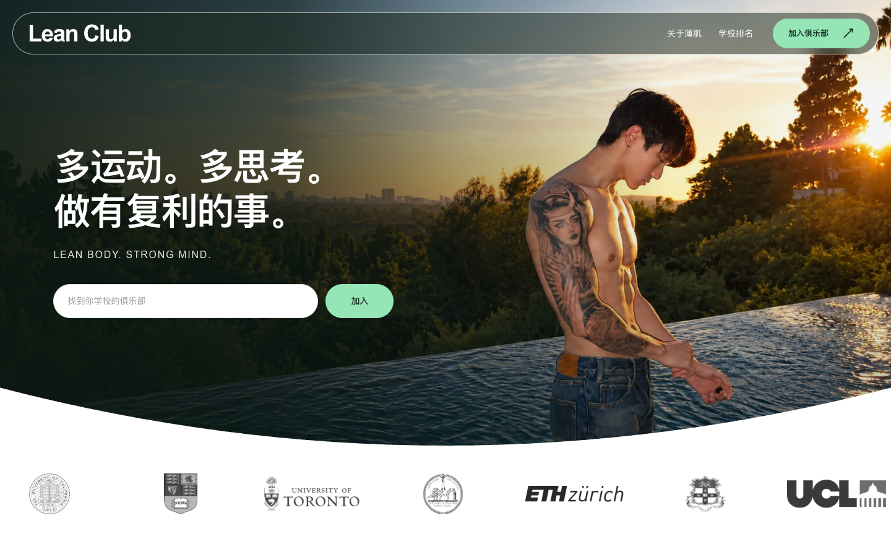

<a href="https://leanmuscleclub.com/">
  
</a>

<p align="center">
  <a href="https://leanmuscleclub.com/"><strong>访问网站 ↗</strong></a>
  &nbsp;&nbsp; · &nbsp;&nbsp;
  <a href="https://leanmuscleclub.com/schools"><strong>找到你的学校 ↗</strong></a>
</p>

## 学校不同，一起向上。

**Lean Club** 是连接不同高校薄肌同好的俱乐部网站。

搜索自己的学校，找到俱乐部，了解负责人联系方式。也让每个正在组织训练的人，有一个能被同校同好找到的入口。

## 从这里，找到同好。

| 想做什么 | 从哪里开始 |
| :--- | :--- |
| **找到本校俱乐部** | 在首页输入学校中文名、英文名或简称，进入对应俱乐部。 |
| **看看全球有哪些学校** | 浏览学校榜单，按国家／地区筛选，查看各校填写的群人数。 |
| **了解如何加入** | 打开俱乐部详情，查看已填写的负责人联系方式与抖音二维码。 |

> **榜单按各校俱乐部填写的群人数排序，群人数由各校负责人提供，不代表独立会员人数或学校在校人数。**

## 简单开始，持续完善。

前端使用 HTML、CSS 和 JavaScript，后端使用 Python 标准库与 SQLite。支持手机与电脑浏览，包含学校搜索、地区筛选与俱乐部详情。

公开仓库提供网站代码、展示素材、学校基础目录及测试。**线上用户填报资料和服务器凭据不在仓库中。** 本地运行使用独立数据库。

<details>
<summary><strong>在本地运行 →</strong></summary>

需要 Python 3.9+，无需安装第三方 Python 依赖。

```bash
git clone https://github.com/xiao222xian/LEANCLUB.git
cd LEANCLUB
```

在仓库根目录打开两个终端。

**终端一 · 启动 API**

```bash
CLUB_DB="$PWD/data/clubs.sqlite3" \
CLUB_ORIGIN="http://127.0.0.1:4180" \
python3 backend/server.py
```

**终端二 · 启动网页**

```bash
python3 scripts/preview.py
```

打开 <http://127.0.0.1:4180/>。本地首次运行创建空数据库，不会读取或修改线上用户资料。

**运行测试**

```bash
python3 -m unittest discover -s tests -v
```

完整的数据说明、目录结构和部署注意事项见[开发文档](docs/development.md)。

</details>

<br />

**一起完善这个入口。** 学校名称、地区或搜索匹配有误，欢迎[提交 Issue](https://github.com/xiao222xian/LEANCLUB/issues)；功能改进与代码修复也欢迎通过 Pull Request 交流。请勿在公开 Issue 中填写私人联系方式、修改链接或密钥。

学校标识仅用于识别对应俱乐部，不代表学校官方合作或背书。第三方图片与标识的权利归各自权利人，详情见[素材来源](web/creator/images/campus-logo-sources.txt)及[学校信息来源](docs/school-metadata-sources.md)。

---

<p align="center">
  <strong>Lean body. Strong mind.</strong><br />
  <sub>多运动。多思考。做有复利的事。</sub>
</p>
