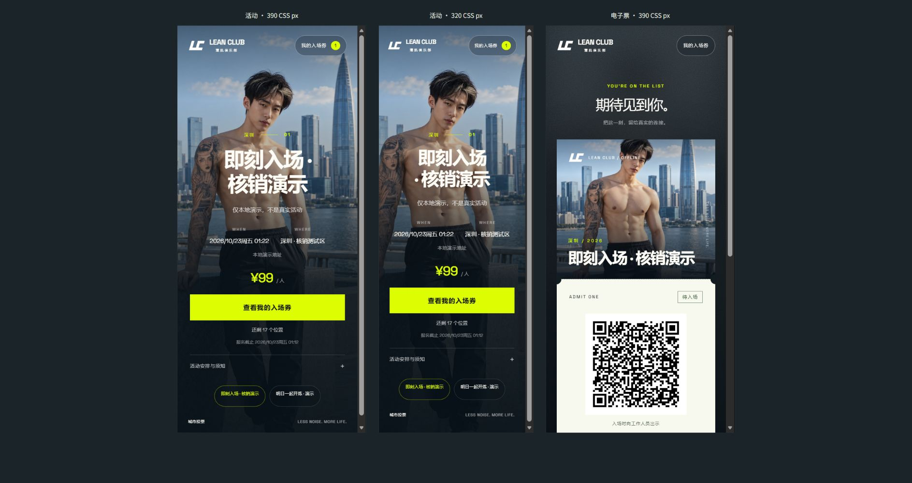

# 付费活动开发版 · 联调记录

日期：2026-10-23。此版本在本机隔离数据库验证，未部署到 `boji.tensorbot.xyz`，未实际收款或退款。

## 已验证

- Python 全量127项测试通过，其中19项为活动/订单新增测试，详见[后端记录](events-backend-qa-20261023.md)。
- `node tests/test_events_public.cjs` 通过：六种支付状态下的二维码显示、缺失支付状态拒绝出票、退款申请语义、重试幂等、用户确认报价冻结，以及首次访客身份请求串行完成。该脚本为隔离DOM状态验证，不能代替真实浏览器。
- 五份新增或修改JavaScript通过Node语法检查；本地启动器、预览代理与部署脚本通过Python编译。
- 本地 `/events`、`/ticket`、`/check-in` 及尾斜线路径和活动列表API均返回200，HTML/JSON响应类型正确。
- Nginx配置生成通过，模板与安装器包含新增路由。未在远端执行新版本安装、`nginx -t` 或支付验收。
- 浏览器实际完成下单、待付无二维码、测试到账后出票与PNG下载；最终下载图1000×1870，866,911字节，完整图片已复核。活动与票面窄屏通过真实页面iframe的390/320 CSS视口查看，见[前台验收](events-public-qa-20261023.md)。
- 浏览器实际完成活动创建/精确改价/发布与停止、订单筛选、脱敏展开、核销预览/确认/重复提示，以及未付和取消票拒绝，见[管理与核销验收](events-admin-qa-20261023.md)。

## 隔离环境

本机演示入口为 `http://127.0.0.1/events`，网页80、API5389。数据库、临时账号、票据凭证及专用测试启动器均保存在Git忽略的 `data/events-qa-20261023/`，不导入生产。示例活动明确标注“演示”，不代表正式活动安排或实际售价。

测试启动器只在进程内启用合成支付能力，浏览器不能调用任何“付款成功”接口。待支付截图完成后，测试辅助函数为唯一QA订单构造已付状态，再验证票面和核销；这不是商户支付回调、到账或退款凭证。

## 待完成的上线部分

收款方式仍待选择。正式接入须完成渠道配置、可信到账确认、金额与交易唯一性校验、关单和迟到款处理、真实退款及端到端验收。未配置渠道的普通启动和生产配置会拒绝下单。

手机系统相机/微信扫码、真实网络下的现场核销和真实资金流程未验收。第一版核销共用管理员身份，独立工作人员权限和跨设备身份找回尚未实现。
